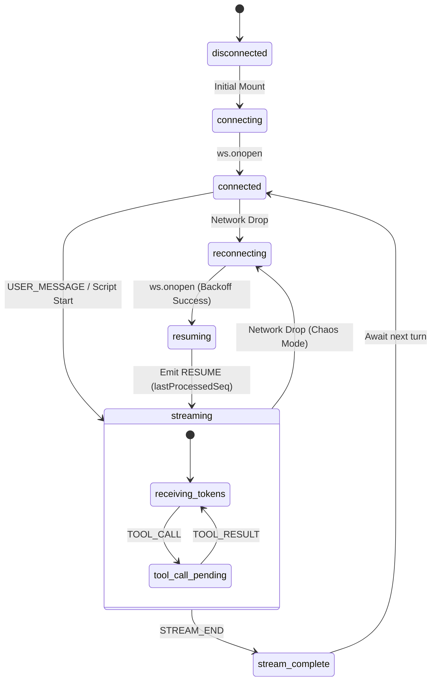
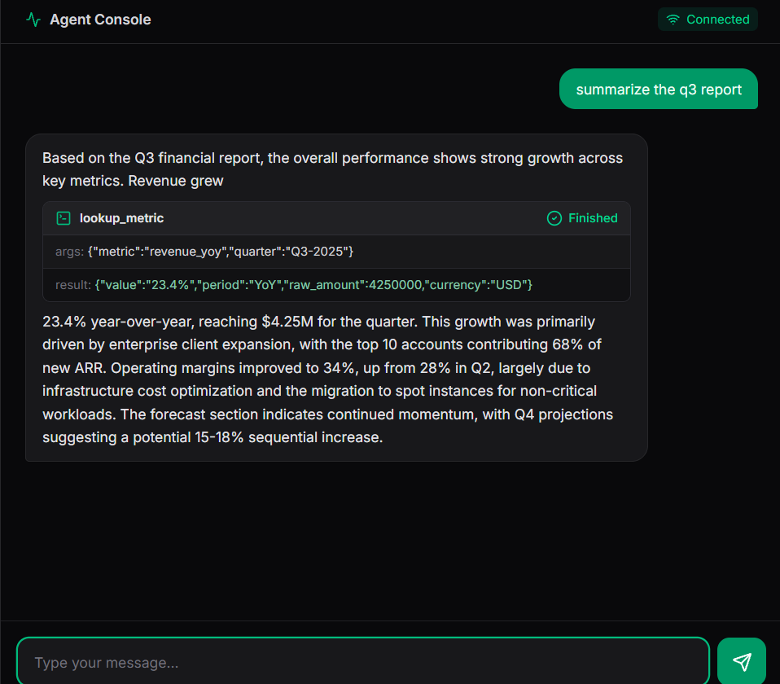
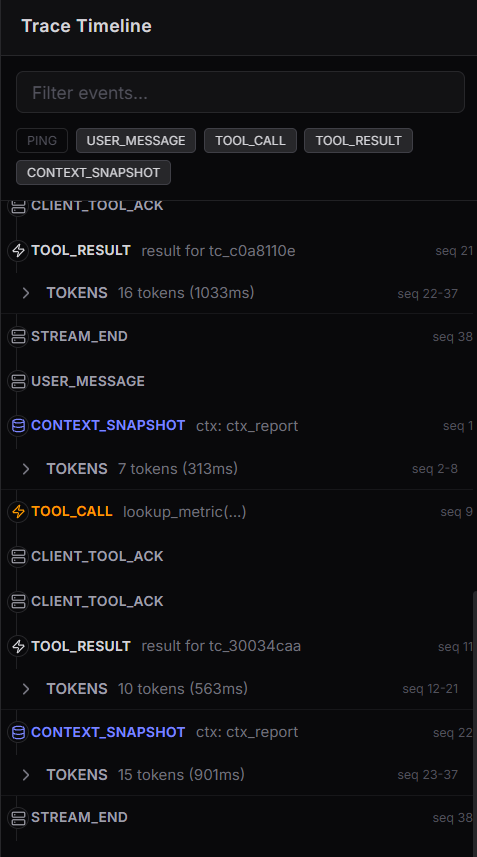
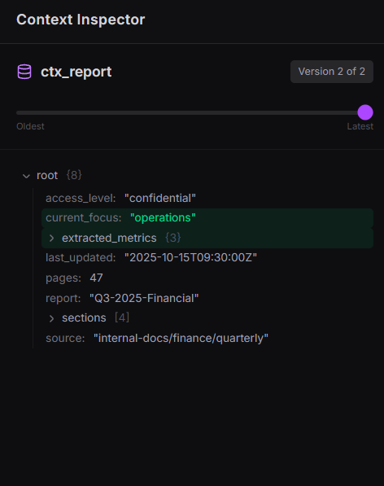

# Alchemyst Agent Console

A resilient, real-time interface for AI agents, built to survive hostile network conditions (Chaos Mode) without sacrificing UI/UX fluidity.

## Architectural Approach
This Agent Console strictly separates transport-layer resilience from React's rendering lifecycle by using a Zustand-powered sequence buffer. Raw WebSocket events are dropped into an O(1) deduplication Map, ensuring the UI only ever processes perfectly ordered events (`lastProcessedSeq + 1`), even if the backend drops or shuffles packets. To prevent layout thrashing during tool execution, token streams are dynamically partitioned into localized inline chunks, allowing tool cards to seamlessly interrupt the text stream without DOM re-calculations.

> **Note:** For a deep dive into the engineering trade-offs, `seq`-based ordering logic, and handling of 50+ concurrent streams, please read [DECISIONS.md](./DECISIONS.md).

## Connection & Stream State Machine

The following diagram illustrates the application's internal state machine, specifically highlighting how it gracefully handles mid-stream network drops and tool call interruptions:



## Running the Application Locally

The application consists of the Next.js frontend and the provided mock Agent Server. 

**1. Start the Agent Server (Backend)**
Start the provided mock backend using Docker (as per the assignment guidelines):
```bash
cd agent-server
docker build -t agent-server .

# Normal mode:
docker run -p 4747:4747 agent-server

# Chaos mode (simulating drops, latency, and out-of-order packets):
docker run -p 4747:4747 agent-server --mode chaos
```
*(Alternatively, if you don't have Docker running locally, you can start the server natively with `npm install` and `npm run dev -- --mode chaos`)*

### Testing Chaos Recovery
Instead of constantly restarting your Docker container to simulate network failures, the UI features built-in **Chaos Interceptors**. 
While the backend is running in chaos mode, simply type the following commands directly into the Chat input bar:
- `/drop` — Instantly severs the WebSocket connection, demonstrating the UI's exponential backoff and `RESUME` sequence buffer recovery.
- `/droptool` — Severs the connection specifically while a tool is executing to prove the decoupled render lifecycle gracefully handles abandoned/replayed tool states.
- `/error` — Injects a mocked client-side rendering error to demonstrate React error boundaries.

**2. Start the Agent Console (Frontend)**
In a new terminal window, return to the project root and start the production build. **(The frontend does NOT use Docker, per the assignment instructions).**
```bash
# Install dependencies
npm install

# Build and start the production server
npm run build
npm run start
```
The console will be available at `http://localhost:3000`.

---

## Deliverables

### 1. Chaos Mode Screen Recording
The mandatory screen recording demonstrating the frontend surviving Chaos Mode (dropped connections, rapid tools, corrupt heartbeats) can be found here: 
**[Watch Chaos Mode Demonstration](https://youtu.be/0KTs-GTpkdw)**

### 2. Normal Mode Screenshots

**A) Streamed Response & Tool Call**
*Demonstrates a tool call seamlessly interrupting a token stream without layout shift.*


**B) Trace Timeline**
*Demonstrates batched token rendering and grouped WS events maintaining 60fps.*


**C) Context Inspector Diff**
*Demonstrates the recursive JSON diff engine highlighting newly added context keys in green.*


---

## Premium Polish
To demonstrate product empathy, the following premium features have been integrated:
- **Interactive Resilience Testing:** The chat input intercepts `/drop`, `/droptool`, and `/error` commands, allowing you to manually trigger WebSocket disconnections and client-side errors directly from the UI to observe the auto-recovery in real-time.
- **Mathematical Unit Tests:** A rigorous Vitest suite (`src/store/useAgentStore.test.ts`) that programmatically blasts the Zustand sequence buffer with out-of-order `seq` packets to mathematically prove the O(1) deduplication logic perfectly resolves chaotic network drops.
- **Framer Motion Integration:** Instead of jarring layout snaps, UI components (Chat Messages, Tool Cards, Timeline Rows, and Context Inspector Trees) utilize `<AnimatePresence>` and layout animations to slide and fade in buttery-smoothly.
- **GitHub Flavored Markdown:** The Chat Panel uses `react-markdown` and `react-syntax-highlighter` (VS Code Dark+ theme) to parse agent responses, ensuring code blocks and formatted text look pristine.
